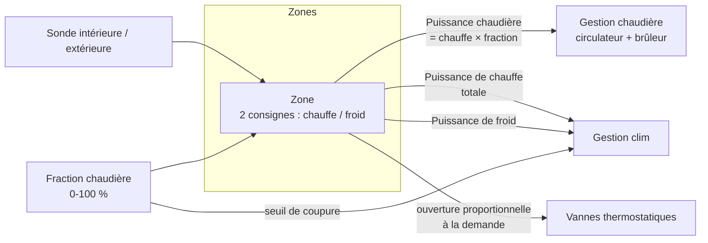

# Super Thermostat

Intégration Home Assistant qui reprend le moteur du plugin *Thermostat* de Jeedom (régulation proportionnelle au temps, avec anticipation sur la température extérieure et **auto-apprentissage**) et le sépare en deux rôles :

- des **zones** qui calculent chacune un **pourcentage** de chauffe ou de froid, sans piloter aucun appareil ;
- des **gestionnaires** (chaudière, clim) qui additionnent ces pourcentages et pilotent les appareils.

Tout se configure depuis l'interface de Home Assistant, aucun YAML n'est nécessaire.

> Prérequis : Home Assistant **2026.10** ou plus récent.

---

## Sommaire

1. [Vue d'ensemble](#vue-densemble)
2. [Installation](#installation)
3. [Mise en route pas à pas](#mise-en-route-pas-à-pas)
4. [Les quatre types d'entrées](#les-quatre-types-dentrées)
   - [Zone](#1-zone)
   - [Fraction chaudière](#2-fraction-chaudière)
   - [Gestion chaudière](#3-gestion-chaudière)
   - [Gestion clim](#4-gestion-clim)
5. [Comment ça calcule](#comment-ça-calcule)
6. [Exemples](#exemples)
7. [Dépannage](#dépannage)
8. [Sécurité et limites](#sécurité-et-limites)
9. [Historique des versions](#historique-des-versions)
10. [Crédits et licence](#crédits-et-licence)

---

## Vue d'ensemble



- Une **zone** = une pièce (ou un groupe de pièces) avec **deux consignes** : chauffe et froid. L'écart entre les deux est une zone morte, la chauffe et la clim ne peuvent pas se battre.
- La **fraction chaudière** dit quelle part de la chaleur vient de la chaudière selon la météo : 0 % quand il fait doux, 100 % quand il fait froid (la clim réversible prend le relais quand il fait doux).
- La **gestion chaudière** additionne les puissances reçues (plafonnées à 100 %), allume le circulateur dès qu'il y a une demande et règle la température d'eau selon la puissance.
- La **gestion clim** allume, règle et éteint la clim réversible selon la puissance de la zone.

---

## Installation

### Manuelle ou avec git

1. Copier le dossier `custom_components/super_thermostat/` dans `/config/custom_components/` de Home Assistant.
2. Redémarrer Home Assistant.
3. Aller dans **Paramètres → Appareils et services → Ajouter une intégration → Super Thermostat**.

Avec un dépôt git (`https://github.com/Maxime-roche/super_thermostat`), il suffit de cloner ou de tirer (`git pull`) le dépôt dans `/config` puis de redémarrer. Le bouton **?** de l'intégration (Paramètres → Appareils et services) ouvre cette page.

### HACS (dépôt personnalisé)

**HACS → ⋮ → Dépôts personnalisés**, ajouter `https://github.com/Maxime-roche/super_thermostat` avec la catégorie *Intégration*, puis installer et redémarrer.

### Mise à jour

Remplacer le dossier `custom_components/super_thermostat/`, redémarrer. Les coefficients appris, les consignes et les préréglages sont conservés (ils sont enregistrés par Home Assistant).

---

## Mise en route pas à pas

Ordre conseillé :

1. **Fraction chaudière** (si tu as une chaudière et une clim réversible) : créer l'entrée, puis vérifier les deux fractions et les deux températures qu'elle expose.
2. **Zones** : créer une zone par pièce. Dans *Configurer*, renseigner la fraction et la saison (*Sondes, type et cycle*) et, si tu as des vannes, l'onglet *Vannes thermostatiques*.
3. **Gestion chaudière** : choisir les relais, la sonde d'eau et les sources (les capteurs « Puissance chaudière » des zones).
4. **Gestion clim** : choisir le `climate` et les sources (les capteurs « Puissance de chauffe » des zones).
5. **Active « Simulation »** sur la chaudière et la clim. Observe pendant un moment les capteurs de statut et les seuils : rien n'est envoyé aux appareils.
6. Désactive tes anciennes automatisations qui pilotent les mêmes appareils, puis **désactive la simulation**.

---

## Les quatre types d'entrées

Chaque type s'ajoute depuis *Ajouter une intégration → Super Thermostat*. Les réglages avancés sont dans **Configurer** de chaque entrée (une explication est affichée sous chaque champ).

### 1. Zone

**À la création**

| Champ | Rôle |
|---|---|
| Nom | Nom de la zone. |
| Sonde de température intérieure | N'importe quelle entité numérique : `sensor`, `input_number`, `number`, ou une entité `weather` / `climate` (température lue dans ses attributs). |
| Sonde de température extérieure | Facultatif, mêmes types d'entités. Sans elle, la zone raisonne sans anticipation météo. |
| Type de zone | **Chauffage** (chaudière), **Climatisation**, ou **Chauffage + froid** (Auto, deux consignes). |
| Durée du cycle | Période de recalcul du pourcentage (5 à 240 min). Sert aussi de fenêtre de mesure pour l'apprentissage : 30 à 60 min conviennent. |

**Configurer → Sondes, type et cycle** : les champs ci-dessus, plus

| Champ | Rôle |
|---|---|
| Fraction chaudière | Entité 0-100 % (au choix : fraction « moyenne de la veille » ou « température actuelle » de l'entrée Fraction chaudière, ou toute autre entité). Puissance chaudière = puissance de chauffe × fraction. Vide = 100 %. |
| Entité « saison » | `input_boolean` / `switch` / `binary_sensor` : ON = été = froid. Sert au mode Auto. |
| Âge max de la sonde | Sans nouvelle valeur pendant ce délai : statut « défaillance sonde ». |
| Puissance en cas de défaillance | Puissance demandée si la sonde est absente (0 par défaut). |

**Configurer → Vannes thermostatiques** : voir [Vannes thermostatiques](#vannes-thermostatiques).

**Configurer → Régulation**

| Champ | Rôle |
|---|---|
| Puissance minimale | Sous ce pourcentage, la zone ne demande rien (5 % par défaut). |
| Limiter les cycles marche/arrêt | Une fois en chauffe, la zone ne s'arrête que sous 1 % au lieu de la puissance minimale. |
| Auto-apprentissage | La zone ajuste seule ses coefficients. À désactiver pour les figer. |
| Seuil « cycle précédent chaud » et Réduction après un cycle chaud | Compensent l'inertie d'un radiateur encore chaud : le cycle suivant est réduit. 0 = désactivé. |
| Marges de détection de défaillance | Si la température reste trop loin de la consigne et dans le mauvais sens pendant 2 cycles, statut « défaillance chauffage / clim ». |

**Configurer → Fenêtres** : capteurs d'ouverture, délai avant arrêt (2 min) et délai avant reprise (2 min).

**Entités créées**

| Entité | Description |
|---|---|
| `climate.<zone>` | Modes `off`, `heat`, `cool`, `heat_cool` (selon le type), consigne(s), préréglages `none`, `home`, `sleep`, `away`. |
| Puissance de chauffe | Pourcentage total demandé en chauffe. |
| Puissance chaudière | Puissance de chauffe × fraction (attribut `fraction`). |
| Puissance de froid | Pourcentage demandé en froid (zones avec froid). |
| Statut | `heating`, `cooling`, `idle`, `off`, `suspended` (fenêtre), `sensor_failure`, `actuator_failure`. |
| Défaillance | Binaire, ON si panne de sonde ou de chauffage. |
| `number` (configuration) | Coefficients appris, offsets, delta consigne, consignes des préréglages. |
| Bouton « Réinitialiser l'apprentissage » | Repart des coefficients par défaut. |

**Deux consignes et sens actif**

- Mode **Chauffage** ou **Froid** : le sens est forcé.
- Mode **Auto** (`heat_cool`) :
  - avec une entité « saison » : ON = froid, OFF = chauffe ;
  - sans : sous la consigne de chauffe, la zone chauffe ; au-dessus de la consigne de froid, elle refroidit ; entre les deux (zone morte), elle garde le sens précédent.
- La consigne de chauffe ne dépasse jamais celle de froid : si tu pousses l'une au-delà de l'autre, l'autre suit.
- **Consigne de froid à 35 °C = clim coupée.**

#### Vannes thermostatiques

Dans **Configurer → Vannes thermostatiques**, une zone peut piloter les vannes de ses radiateurs (entités `number` d'ouverture, par exemple `…_valve_setpoint`).

| Champ | Rôle |
|---|---|
| Vannes | Les entités d'ouverture à piloter (plusieurs radiateurs d'une même pièce se pilotent ensemble). |
| Pilotage des vannes | **Proportionnel à la demande** (recommandé), **Suivre la fraction chaudière** ou **Entité personnalisée**. |
| Demande suivie | Mode proportionnel : la **puissance chaudière** de la zone (recommandé : c'est la part de chaleur que fournissent les radiateurs) ou la puissance de chauffe totale. |
| Ouverture à 1 % de demande | Par exemple 15 %. |
| Ouverture à 100 % de demande | Par exemple 70 %. Entre les deux, l'ouverture varie linéairement. |
| Écart minimal avant de changer l'ouverture | La vanne n'est modifiée que si l'ouverture voulue diffère d'au moins ce pourcentage de l'ouverture actuelle (5 % par défaut). La fermeture complète est toujours appliquée. |
| Garder ouvert tant qu'aucune autre zone ne demande | Voir ci-dessous (activé par défaut). |
| Entité d'ouverture | Mode personnalisé : une entité 0-100 calculée ailleurs (template, `input_number`…). |

**Mode proportionnel.** Avec 15 % à 1 % et 70 % à 100 % : une demande de 1 % ouvre à 15 %, 50 % à environ 43 %, 100 % à 70 %. Une plage réduite évite les vannes très ouvertes, qui font chauffer les radiateurs au détriment des autres pièces, et très fermées, qui laissent passer trop peu de débit. Mettre la même valeur aux deux extrémités donne un fonctionnement ouvert / fermé.

**Quand la demande tombe à 0.** Avec « Garder ouvert » (par défaut), la vanne reste à son ouverture actuelle tant qu'aucune autre zone ne demande de chaudière, car circulateur et brûleur sont alors à l'arrêt et fermer la vanne pour la rouvrir plus tard ne sert à rien. Dès qu'une autre zone demande de la chaudière, la vanne se ferme (pour ne pas chauffer une pièce qui n'en a pas besoin). Sans cette option, elle se ferme tout de suite.

**Autres modes.** *Suivre la fraction chaudière* : ouverture = fraction. *Entité personnalisée* : ouverture = valeur de l'entité choisie.

Dans tous les modes : rien n'est envoyé en froid, en été (entité « saison » ON), ni quand l'écart avec l'ouverture actuelle est inférieur à l'écart minimal, ce qui épargne les piles. Les vannes sont recalculées à chaque cycle de la zone, à chaque changement de demande d'une zone et à chaque changement des entités suivies. Le capteur **Ouverture des vannes** de la zone affiche l'ouverture voulue, avec en attributs le mode, la demande suivie, la demande des autres zones et l'état des vannes.

> Conseils : pour une vanne sans pièce dédiée, rattache-la à la zone voisine ou crée une zone avec la température de la vanne comme sonde (les sondes intégrées aux vannes mesurent souvent trop chaud près du radiateur). Si la pompe est à vitesse fixe, garder un by-pass hydraulique quand presque toutes les vannes sont fermées.

**Préréglages** : `home` (Jour), `sleep` (Nuit), `away` (Parti). Ils portent les noms standards de Home Assistant, donc la tuile « préréglages » affiche leurs icônes. Chacun a une consigne de chauffe et une de froid, réglables dans les entités `number` de la zone.

**Réglages manuels**

- **Delta consigne** (0 par défaut = désactivé) : écart de lissage autour de la consigne, valable pour la chauffe et le froid. Avec 1 °C, la zone ne commence à chauffer que si le besoin existe à consigne − 0,5 °C, et vise alors consigne + 0,5 °C. Utile pour limiter les allers-retours sur une pièce qui oscille ; l'effet est modeste quand la température extérieure est basse.
- **Offset chauffe / froid** : pourcentage ajouté à la puissance calculée (0 par défaut), pour compenser une pièce structurellement trop froide ou trop chaude.
- Ces réglages **ne changent jamais seuls** (contrairement aux coefficients, qui sont appris) et s'appliquent immédiatement.

### 2. Fraction chaudière

Remplace un capteur `template` « fraction chaudière ». À partir d'**une seule entité de température**, l'entrée calcule en permanence deux fractions et expose les deux températures :

| Entité | Description |
|---|---|
| **Fraction chaudière (moyenne de la veille)** | Fraction calculée sur la **moyenne de la veille** (historique de l'entité). Valeur stable toute la journée, mise à jour à 00:05. |
| **Fraction chaudière (température actuelle)** | Fraction calculée sur la **température actuelle**, en temps réel. |
| **Température moyenne de la veille** | Attributs `source` (`history`, `cache` ou `fallback`) et `as_of`. |
| **Température actuelle** | Valeur lue sur l'entité source. |

Chaque zone, la gestion clim ou une vanne choisit **laquelle des deux fractions suivre** : il n'y a donc plus de mode à régler.

| Champ | Rôle |
|---|---|
| Entité de température | Une entité numérique (ou `weather` / `climate`, sans moyenne de la veille dans ce cas). |
| Température de repli | Utilisée pour une température introuvable (10 °C). |
| Seuil haut | Au-dessus : 0 % de chaudière (9 °C). |
| Seuil bas | En dessous : 100 % de chaudière (−3 °C). |
| Fraction minimale d'utilisation | Sous ce pourcentage, la fraction passe à 0 % : les radiateurs seraient trop peu ouverts pour que la chaudière serve (15 %). |

Entre les deux seuils, la fraction varie linéairement. Les deux fractions ont les attributs `raw_fraction` (avant seuil minimal), `min_fraction` et `source`.

> La moyenne de la veille lit l'historique du recorder (valeurs numériques de l'entité). Si la lecture échoue, la dernière valeur connue est utilisée, puis la température de repli.

### 3. Gestion chaudière

Une seule entrée.

| Champ | Rôle |
|---|---|
| Relais du brûleur, relais du circulateur | `switch` ou `input_boolean`. |
| Sonde de température d'eau | Température de la chaudière. |
| Sources de puissance | Entités numériques additionnées et plafonnées à 100 % : en général les capteurs « Puissance chaudière » des zones. Tu peux en ajouter d'autres à la main. |

**Configurer → Temporisations et sécurité** : post-circulation (0 min), durée mini brûleur allumé (2 min) et éteint (2 min), température de sécurité (85 °C), âge max de la sonde d'eau (10 min).

**Entités** : Demande totale, Seuil bas eau, Seuil haut eau, Statut (`disabled`, `idle`, `circulating`, `heating`, `water_sensor_failure`, `safety_cutoff`), Brûleur, Circulateur, interrupteurs **Gestion active** et **Simulation**, et trois réglages :

- **Température d'eau à 1 %** (20 °C), **à 100 %** (72 °C) et **décalage seuil bas / haut** (5 °C).

### 4. Gestion clim

Remplace une automatisation qui allume, règle et éteint une clim réversible.

| Champ | Rôle |
|---|---|
| Clim | L'entité `climate`. |
| Sources de puissance de chauffe | En général les capteurs « Puissance de chauffe » (totale) des zones. |
| Sources de puissance de froid | Facultatif : les capteurs « Puissance de froid ». Sans elles, la gestion ne s'occupe que de la chauffe. |
| Fraction chaudière | Facultatif : sert d'interrupteur (voir plus bas). |
| Entité « saison » | Facultatif : ON = froid, OFF = chauffe. |

**Configurer → Temporisations** : délai avant allumage (10 min), intervalle de réglage de la consigne (5 min), durée mini d'allumage (5 min), pause entre le mode et la consigne (20 s).

**Entités** : Demande, Consigne envoyée à la clim, Statut (`disabled`, `idle`, `heating`, `cooling`, `fraction_cutoff`, `summer_season`), interrupteurs **Gestion active** et **Simulation**, et les réglages :

- décalage de la consigne de chauffe à 0 % (−1 °C) et à 100 % (+3 °C) ;
- décalage de la consigne de froid à 0 % (+1 °C) et à 100 % (−3 °C) ;
- **seuil de coupure** sur la fraction (100 %).

---

## Comment ça calcule

### Zone

À chaque cycle :

```
puissance % = sens × (consigne − T intérieure) × coeff_int
            + sens × (consigne − T extérieure) × coeff_ext
            + offset
```

bornée entre 0 et 100. Le premier terme corrige l'écart ; le second **anticipe** les déperditions grâce à la température extérieure.

- **Auto-apprentissage** : à la fin d'un cycle, la zone compare la montée en température obtenue à celle attendue et corrige ses coefficients par moyenne pondérée (le poids monte jusqu'à 50 : « 50 = apprentissage terminé »). Quatre coefficients : chauffe et froid, intérieur et extérieur. Une mesure aberrante ne peut pas déplacer un coefficient de plus d'un facteur 3.
- L'apprentissage est sauté quand le cycle précédent a été interrompu (zone arrêtée, fenêtre ouverte, panne de sonde) ou quand la puissance était nulle ou saturée.
- **Défaillance du chauffage** : détectée seulement quand l'apprentissage est mûr (compteur au-dessus de 25), après deux cycles de suite.
- Un coefficient réglé à la main ré-initialise son compteur à 10.
- Le pourcentage est **constant pendant tout le cycle** : une zone ne commute rien.

### Chaudière

- Demande = somme des sources, plafonnée à 100 %.
- Le circulateur s'allume dès que la demande est positive (et reste allumé la durée de post-circulation).
- Le seuil bas d'eau varie linéairement de la température à 1 % jusqu'à (température à 100 % − décalage) ; le seuil haut = seuil bas + décalage. Avec 20 °C, 72 °C et 5 °C : à 1 %, 20 à 25 °C ; à 100 %, 67 à 72 °C.
- Le brûleur s'allume sous le seuil bas, s'éteint au-dessus du seuil haut et ne change pas entre les deux. Il s'éteint immédiatement s'il n'y a plus de demande, si la sonde d'eau est muette ou si la température de sécurité est atteinte.

### Clim

- Consigne = température mesurée par la clim + décalage, arrondie à l'entier. Le décalage varie linéairement avec la demande.
- Allumage seulement si le délai depuis le dernier réglage est écoulé ; la consigne n'est renvoyée que si elle diffère de celle de la clim, au plus toutes les 5 min.
- **Fraction** : elle n'agit que comme interrupteur. Sous le seuil de coupure, la clim suit la puissance totale (sans être réduite par la fraction). Au seuil ou au-dessus, elle s'arrête immédiatement.
- Entre la fraction minimale et le seuil de coupure, la chaudière et la clim chauffent donc ensemble.

---

## Exemples

### Tuile avec les préréglages

```yaml
type: tile
entity: climate.sejour
vertical: false
features:
  - style: icons
    type: climate-preset-modes
    preset_modes:
      - none
      - home
      - sleep
      - away
features_position: inline
```

### Choisir le préréglage depuis une automatisation

```yaml
alias: Préréglage selon le mode de la maison
triggers:
  - trigger: state
    entity_id: input_select.mode_maison
actions:
  - action: climate.set_preset_mode
    target:
      entity_id: climate.sejour
    data:
      preset_mode: >-
        {{ {'Jour': 'home', 'Nuit': 'sleep', 'Parti': 'away'}[trigger.to_state.state] }}
mode: single
```

### Fixer deux consignes

```yaml
action: climate.set_temperature
target:
  entity_id: climate.sejour
data:
  target_temp_low: 21
  target_temp_high: 24
```

---

## Dépannage

### La clim ne démarre pas

Ouvrir les attributs du capteur **Statut** de la gestion clim (Outils de développement → États). L'attribut `reason` dit ce qui se passe, le même texte est écrit dans les journaux à chaque changement :

| `reason` | Signification |
|---|---|
| `disabled` | L'interrupteur « Gestion active » est éteint. |
| `summer_entity_on` | L'entité « saison » est ON et aucune source de froid n'est renseignée : la gestion ne touche à rien. |
| `climate_unavailable` | L'entité `climate` est indisponible. |
| `fraction_cutoff` | La fraction a atteint le seuil de coupure. |
| `no_demand` | Les sources donnent 0 % (vérifier que ce sont bien les capteurs de puissance des zones). |
| `waiting_start_delay` | Une demande existe, mais le délai depuis le dernier réglage n'est pas écoulé. |
| `regulating` | La clim est dans le bon mode, la consigne est ajustée. |
| `dry_run_would_act` | Simulation active : voir `pending_actions`. |
| `acting` | Des commandes viennent d'être envoyées. |

Les attributs `sources`, `fraction`, `climate_mode`, `setpoint_computed` et `seconds_since_last_change` complètent le diagnostic.

### Autres cas courants

| Symptôme | Piste |
|---|---|
| La zone reste « Au repos » | Mode Auto sans entité saison, température dans la zone morte entre les deux consignes. |
| « Défaillance sonde » | La sonde n'a pas de nouvelle valeur depuis plus que « Âge max de la sonde ». |
| Les coefficients ne bougent pas | Auto-apprentissage désactivé, ou puissance toujours nulle ou saturée à 100 %. |
| Fraction à 0 % alors qu'il fait froid | Fraction minimale non atteinte, ou température absente : voir `raw_fraction` et `source` des fractions, et « Température moyenne de la veille ». |
| La chaudière ne s'allume pas | Vérifier le capteur Statut de la chaudière (`water_sensor_failure`, `safety_cutoff`) et que « Simulation » est éteint. |
| Anciennes entités « non disponibles » après une mise à jour | Supprimer les entités orphelines dans Paramètres → Entités. |

---

## Sécurité et limites

- **Prévoir un arrêt local sur les relais** (minuterie auto-off, par exemple) : si Home Assistant ne répond plus, les relais gardent leur dernier état.
- **La simulation** est là pour valider les seuils avant le premier vrai démarrage.
- **Quotas d'API** : si la clim passe par un service cloud avec un nombre de commandes par jour limité, les délais par défaut (réglage toutes les 5 min, allumage 10 min) peuvent ne pas suffire en théorie. Passer l'intervalle de réglage à 10 min plafonne à 144 réglages par jour.
- Pas de planning intégré : utiliser des automatisations pour changer de préréglage.
- Une seule gestion chaudière par installation.
- La température est lue en °C (conversion automatique si l'entité est en °F).

---

## Historique des versions

| Version | Changements |
|---|---|
| 0.7.1 | Explications ajoutées sous les champs qui n'en avaient pas. |
| 0.7.0 | Onglet « Vannes thermostatiques » dans les options des zones ; ouverture proportionnelle à la demande (plage réglable), écart minimal, vannes gardées ouvertes tant qu'aucune autre zone ne demande ; capteur « Ouverture des vannes ». |
| 0.6.0 | Fraction chaudière : fractions « température actuelle » et « moyenne de la veille » (plus de mode à choisir) et leurs deux températures ; vannes : trois modes (demande, fraction, personnalisé) ; préréglages fixes (Vacances retiré) ; lien du bouton « ? » vers le dépôt. |
| 0.5.1 | Retrait de l'étape « Préréglages » (trois préréglages fixes), les réglages manuels s'appliquent immédiatement. |
| 0.5.0 | Préréglages `home` / `sleep` / `away` avec icônes, explications sous chaque champ, fraction minimale, vannes thermostatiques dans les zones. |
| 0.4.0 | Zone à deux consignes, préréglages à deux consignes, sens actif par saison, froid dans la gestion clim. |
| 0.3.x | Gestion clim (chauffe), seuil de coupure sur la fraction, diagnostics. |
| 0.2.0 | Fraction chaudière, mode simulation, capteurs de température libres. |
| 0.1.0 | Zones, gestion chaudière. |

---

## Crédits et licence

La logique de régulation (cycle, anticipation extérieure, auto-apprentissage, détection de défaillance) est portée du plugin *Thermostat* de [Jeedom](https://www.jeedom.com), publié sous licence **GPLv3**. Ce portage doit donc être redistribué sous la même licence.
