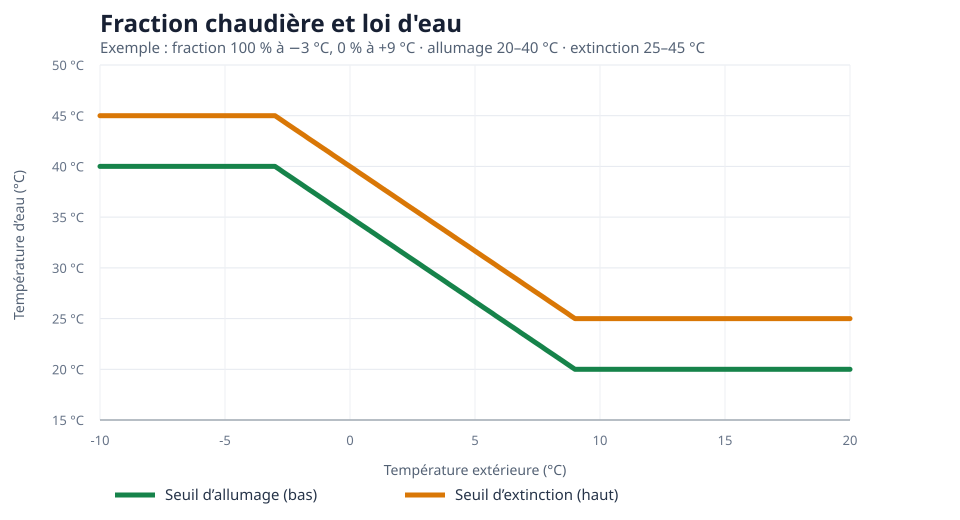

# Super Thermostat

Intégration Home Assistant (**version 1.0**) pour piloter chauffage, clim et vannes thermostatiques **depuis l'interface, sans YAML**. Elle reprend le moteur du plugin *Thermostat* de Jeedom (régulation avec anticipation sur la température extérieure et **auto-apprentissage**) et le sépare en deux rôles : des **zones** qui calculent des pourcentages, et des **gestionnaires** qui pilotent les appareils.


**En 30 secondes**

1. **Mesures** : la température de la pièce et de l'extérieur, les fenêtres, la saison. La *fraction chaudière* dit quelle part de la chaleur vient de la chaudière : 0 % quand il fait doux, 100 % quand il fait froid.
2. **Zone** (une par pièce) : elle a deux consignes, chauffe et froid, et calcule des pourcentages. Elle ne commande aucun appareil.
3. **Gestionnaires** : la chaudière additionne les pourcentages, la clim les suit, les vannes s'ouvrent selon la demande.
4. **Appareils** : brûleur et circulateur, clim réversible, vannes thermostatiques.

> Prérequis : Home Assistant **2026.10** ou plus récent.

---

## Sommaire

1. [Installation](#installation)
2. [Mise en route pas à pas](#mise-en-route-pas-à-pas)
3. [Les quatre types d'entrées](#les-quatre-types-dentrées)
   - [Zone](#1-zone) (dont les [vannes thermostatiques](#vannes-thermostatiques) et les [défaillances](#défaillances))
   - [Fraction chaudière](#2-fraction-chaudière)
   - [Gestion chaudière](#3-gestion-chaudière)
   - [Gestion clim](#4-gestion-clim)
4. [Comment ça calcule](#comment-ça-calcule)
5. [Exemples](#exemples)
6. [Dépannage](#dépannage)
7. [Sécurité et limites](#sécurité-et-limites)
8. [Historique des versions](#historique-des-versions)
9. [Crédits et licence](#crédits-et-licence)

---

## Installation

### Manuelle ou avec git

1. Copier le dossier `custom_components/super_thermostat/` dans `/config/custom_components/` de Home Assistant.
2. Redémarrer Home Assistant.
3. Aller dans **Paramètres → Appareils et services → Ajouter une intégration → Super Thermostat**.

Avec un dépôt git (`https://github.com/Maxime-roche/super_thermostat`), il suffit de cloner ou de tirer (`git pull`) le dépôt dans `/config` puis de redémarrer. Le bouton **?** de l'intégration (Paramètres → Appareils et services) ouvre cette page.

### HACS (dépôt personnalisé)

**HACS → ⋮ → Dépôts personnalisés**, ajouter `https://github.com/Maxime-roche/super_thermostat` avec la catégorie *Intégration*, puis installer et redémarrer.

### Mise à jour

Remplacer le dossier `custom_components/super_thermostat/`, redémarrer. Les coefficients appris, les consignes et les préréglages sont conservés (ils sont enregistrés par Home Assistant).

---

## Mise en route pas à pas

Ordre conseillé :

1. **Fraction chaudière** (si tu as une chaudière et une clim réversible) : créer l'entrée, puis vérifier les deux fractions et les deux températures qu'elle expose.
2. **Zones** : créer une zone par pièce. Dans *Configurer*, renseigner la fraction et la saison (*Sondes et type*) et, si tu as des vannes, l'onglet *Vannes thermostatiques*.
3. **Gestion chaudière** : choisir les relais, la sonde d'eau et les sources (les capteurs « Puissance chaudière » des zones).
4. **Gestion clim** : choisir le `climate` et les sources (les capteurs « Puissance de chauffe » des zones).
5. **Active « Simulation »** sur la chaudière et la clim. Observe pendant un moment les capteurs de statut et les seuils : rien n'est envoyé aux appareils.
6. Désactive tes anciennes automatisations qui pilotent les mêmes appareils, puis **désactive la simulation**.

---

## Les quatre types d'entrées

Chaque type s'ajoute depuis *Ajouter une intégration → Super Thermostat*. Les réglages avancés sont dans **Configurer** de chaque entrée (une explication est affichée sous chaque champ).

### 1. Zone

**À la création**

| Champ | Rôle |
|---|---|
| Nom | Nom de la zone. |
| Sonde de température intérieure | N'importe quelle entité numérique : `sensor`, `input_number`, `number`, ou une entité `weather` / `climate` (température lue dans ses attributs). |
| Sonde de température extérieure | Facultatif, mêmes types d'entités. Sans elle, la zone raisonne sans anticipation météo. |
| Type de zone | **Chauffage** (chaudière), **Climatisation**, ou **Chauffage + froid** (Auto, deux consignes). |
| Durée du cycle | Période de recalcul du pourcentage (5 à 240 min). Sert aussi de fenêtre de mesure pour l'apprentissage : 30 à 60 min conviennent. |

**Configurer → Sondes et type** : les champs ci-dessus (la durée du cycle est dans *Régulation*), plus

| Champ | Rôle |
|---|---|
| Fraction chaudière | Entité 0-100 % (au choix : fraction « moyenne de la veille » ou « température actuelle » de l'entrée Fraction chaudière, ou toute autre entité). Puissance chaudière = puissance de chauffe × fraction. Vide = 100 %. |
| Entité « saison » | `input_boolean` / `switch` / `binary_sensor` : ON = été = froid. Sert au mode Auto. |

**Configurer → Vannes thermostatiques** : voir [Vannes thermostatiques](#vannes-thermostatiques).

**Configurer → Régulation** (zone simple ; la zone combinée a deux onglets, voir plus bas)

| Champ | Rôle |
|---|---|
| Durée du cycle | Période de recalcul du pourcentage (5 à 240 min), déplacée ici depuis *Sondes et type*. |
| Puissance minimale | Sous ce pourcentage, la zone ne demande rien (5 % par défaut). |
| Limiter les cycles marche/arrêt | Une fois en chauffe, la zone ne s'arrête que sous 1 % au lieu de la puissance minimale. |
| Auto-apprentissage | La zone ajuste seule ses coefficients. À désactiver pour les figer. |
| Seuil « cycle précédent chaud » et Réduction après un cycle chaud | Compensent l'inertie d'un radiateur encore chaud : le cycle suivant est réduit. 0 = désactivé. |
| Marge de détection de défaillance | Si la zone chauffe (ou refroidit) mais que la température reste à plus de cette marge de la consigne et continue de s'en éloigner, 2 cycles de suite : statut « défaillance chauffage / clim ». |

**Configurer → Fenêtres** : capteurs d'ouverture, délai avant suspension (2 min) et délai avant reprise (2 min).

**Configurer → Défaillances** : âge max de la sonde, puissance en cas de défaillance et notifications, voir [Défaillances](#défaillances).

**Entités créées**

| Entité | Description |
|---|---|
| `climate.<zone>` | Modes `off`, `heat`, `cool`, `heat_cool` (selon le type), consigne(s), préréglages `none`, `home`, `sleep`, `away`. |
| Puissance de chauffe | Pourcentage total demandé en chauffe. |
| Puissance chaudière | Puissance de chauffe × fraction (attributs `fraction`, `request`, `waiting_valve`). Reste à 0 % tant que la vanne n'a pas confirmé son ouverture, voir [Synchronisation](#synchronisation-vanne--chaudière). |
| Puissance de froid | Pourcentage demandé en froid (zones avec froid). |
| Statut | `heating`, `cooling`, `idle`, `off`, `suspended` (fenêtre), `sensor_failure`, `actuator_failure`. |
| Défaillance | Binaire, ON si panne de sonde ou de chauffage. |
| En attente de la vanne | Binaire (si « Commande en attente » est renseigné), ON tant que la zone demande la chaudière et que toutes ses vannes sont en attente. Attributs `sync_state`, `boiler_request`, `pending`. |
| Vanne qui ne suit pas | Binaire (si les positions réelles des vannes sont renseignées), ON si une vanne reste à plus de 10 % de sa consigne pendant le délai réglé. |
| `number` (configuration) | Coefficients appris, offsets, delta consigne, consignes des préréglages. |
| Bouton « Réinitialiser l'apprentissage » | Repart des coefficients par défaut. |

**Deux consignes et sens actif**

- Mode **Chauffage** ou **Froid** : le sens est forcé.
- Mode **Auto** (`heat_cool`) :
  - avec une entité « saison » : ON = froid, OFF = chauffe ;
  - sans : sous la consigne de chauffe, la zone chauffe ; au-dessus de la consigne de froid, elle refroidit ; entre les deux (zone morte), elle garde le sens précédent.
- La consigne de chauffe ne dépasse jamais celle de froid : si tu pousses l'une au-delà de l'autre, l'autre suit.
- **Consigne de froid à 35 °C = clim coupée.**

#### Vannes thermostatiques

Dans **Configurer → Vannes thermostatiques**, une zone peut piloter les vannes de ses radiateurs (entités `number` d'ouverture, par exemple `…_valve_setpoint`).

| Champ | Rôle |
|---|---|
| Vannes | Les entités d'ouverture à piloter (plusieurs radiateurs d'une même pièce se pilotent ensemble). |
| Position réelle des vannes | Facultatif : un capteur par vanne (par exemple `…_valve_position`), **dans le même ordre que les vannes**. Sert à comparer la position réelle à la consigne envoyée. |
| Commande en attente | Facultatif : un capteur binaire par vanne (par exemple `binary_sensor.…_command_pending`), **dans le même ordre que les vannes**. ON quand une position est envoyée à la vanne, OFF au nouveau télégramme de la vanne. Sert à la [synchronisation avec la chaudière](#synchronisation-vanne--chaudière). |
| Délai avant de renvoyer un ordre à une vanne | 30 minutes par défaut. Voir [Vérification et renvoi des ordres](#vérification-et-renvoi-des-ordres). |
| Alerte « vanne qui ne suit pas » après | Durée en minutes (30 par défaut, 0 = pas d'alerte). L'écart déclenchant est fixe : plus de **10 %** entre la consigne et la position réelle. |
| Demande suivie | **Champ libre** : n'importe quelle entité 0-100 % dont la valeur pilote l'ouverture. **Vide = la demande chaudière réelle de la zone** (recommandé). Ne pas choisir le capteur « Puissance chaudière » de la même zone : il reste à 0 % pendant l'attente de la vanne, ce qui bloquerait la séquence jusqu'au délai maximal. |
| Garder ouvert tant qu'aucune autre zone ne demande | Voir ci-dessous (activé par défaut). |
| Ouverture proportionnelle | **Activée** : l'ouverture suit la demande entre les ouvertures minimale et maximale. **Désactivée** : mode fixe, la vanne s'ouvre à l'ouverture maximale dès que la zone demande de la chaleur (le thermostat de la zone règle déjà la puissance). |
| Fermeture vanne | Ouverture de la vanne quand le thermostat est éteint, et quand une autre zone est en demande si « Garder ouvert » est activé (ou si « Garder ouvert » est désactivé et que la demande tombe à 0). 0 % par défaut = fermeture complète. |
| Ouverture minimale | Mode proportionnel : limite basse (ouverture à 1 % de demande, par exemple 15 %). Vide = 0 %. Non utilisée en mode fixe. |
| Ouverture maximale | Proportionnel : limite haute (ouverture à 100 % de demande, par exemple 70 %). Fixe : ouverture quand la zone demande de la chaleur. |
| Écart minimal avant de changer l'ouverture | La vanne n'est modifiée que si l'ouverture voulue diffère d'au moins ce pourcentage de l'ouverture actuelle (5 % par défaut). |

> Le réglage « Ne jamais fermer complètement » et l'« ouverture fixe » n'existent plus : le premier est remplacé par « Fermeture vanne » (mets-y par exemple 15 % pour ne jamais fermer complètement), la seconde par l'ouverture maximale. Si tu utilisais une ouverture fixe, reporte sa valeur dans « Ouverture maximale ».

**Ouverture proportionnelle activée.** La demande est ramenée à la plage réglée : avec 15 % à 1 % et 70 % à 100 %, une demande de 1 % ouvre à 15 %, 50 % à environ 43 %, 100 % à 70 %. Sans ouverture minimale (champ vide) la limite basse est 0 %. Mettre 0 et 100 aux deux extrémités fait suivre la valeur de l'entité telle quelle. Si l'entité choisie est indisponible, rien n'est envoyé.

**Ouverture proportionnelle désactivée (mode fixe).** Dès que la demande est positive, la vanne s'ouvre à l'ouverture maximale : c'est la zone qui règle la puissance, pas la vanne.

**Thermostat éteint** : la vanne prend la valeur « Fermeture vanne ».

**Quand la demande tombe à 0** (thermostat allumé, valable dans les deux modes) :
1. Avec *Garder ouvert* (par défaut) : la vanne reste à son ouverture actuelle tant qu'aucune autre zone ne demande de chaudière, car circulateur et brûleur sont alors à l'arrêt et fermer pour rouvrir plus tard ne sert à rien. Dès qu'une autre zone demande de la chaudière, la vanne prend la valeur « Fermeture vanne ».
2. Sans *Garder ouvert* : la vanne prend tout de suite la valeur « Fermeture vanne ».

#### Synchronisation vanne / chaudière

Avec « Commande en attente » renseigné, la chaudière n'est autorisée qu'une fois la vanne prête, pour ne pas chauffer des pièces dont la vanne est encore fermée.

**Règle** : la zone est **en attente de la vanne** quand elle demande la chaudière et que **toutes** ses vannes sont en attente (capteur à ON). **Dès qu'au moins une vanne ne l'est plus, on chauffe.** Tant que la zone est en attente, le capteur « Puissance chaudière » reste à **0 %** et le binaire **En attente de la vanne** est ON. La règle ne joue qu'**au démarrage d'une demande** (passage de 0 % à une demande positive) : une fois la chaudière autorisée, un changement d'ouverture en cours de chauffe (par exemple 75 % → 25 %) n'interrompt plus la chaudière.

Détails :
- Au début d'une demande, l'ordre d'ouverture est envoyé **tout de suite** à toutes les vannes, même si une vanne est déjà à la bonne position (l'écart minimal et le délai de renvoi ne s'appliquent pas à cet ordre).
- Une vanne qui n'a pas changé de position n'est pas en attente : la chaudière démarre sans attendre.
- Après l'envoi d'un ordre, 30 secondes sont laissées au capteur pour passer à ON avant de considérer la vanne comme non en attente.
- **Sécurité : après 25 minutes d'attente continue**, la chaudière est autorisée quand même (avertissement dans les journaux, `sync_state` = `timeout`).
- Un capteur « Commande en attente » indisponible est ignoré.
- La demande qui pilote l'ouverture est la demande réelle de la zone, pas la puissance publiée : la vanne s'ouvre pendant l'attente. La climatisation d'une zone combinée n'attend jamais les vannes.
- Sans capteur « Commande en attente », rien ne change : la puissance chaudière est publiée immédiatement.

Dans tous les cas : rien n'est envoyé en froid, en été (entité « saison » ON), ni quand l'écart avec l'ouverture actuelle est inférieur à l'écart minimal (sauf l'ordre de début de demande), ce qui épargne les piles. Les vannes sont recalculées à chaque cycle de la zone, à chaque changement de demande d'une zone et à chaque changement de l'entité suivie. Le capteur **Ouverture des vannes** de la zone affiche l'ouverture voulue, avec en attributs la source, le mode proportionnel ou non, la demande des autres zones, l'état des vannes et, si les positions réelles sont renseignées, la consigne, la position et l'écart de chaque vanne.

#### Vérification et renvoi des ordres

Les vannes sont vérifiées **toutes les minutes**, y compris quand le thermostat est éteint ou à 0 % de demande : si une vanne n'a pas la valeur voulue, l'ordre est envoyé (ou renvoyé).

Certaines vannes sur pile mettent **jusqu'à environ 30 minutes** entre l'ordre et le changement d'état. Pour ne pas les harceler :
- un ordre **différent** est envoyé tout de suite ;
- le **même** ordre n'est pas renvoyé avant le *délai avant de renvoyer un ordre* (30 min) ; passé ce délai, si la vanne n'a toujours pas suivi, il est renvoyé, et ainsi de suite ;
- dès que la vanne est à la bonne valeur (ou à moins que l'écart minimal), il n'y a plus rien à envoyer.

**Suivi de la position réelle.** Si tu renseignes les positions réelles, l'intégration compare pour chaque vanne la position à la consigne envoyée. Quand l'écart dépasse 10 % pendant plus que le délai réglé, l'indicateur **Vanne qui ne suit pas** de la zone s'active (attribut `valves_in_alert` : les vannes concernées, avec position, consigne et écart) et un avertissement est écrit dans les journaux. Le délai repart de zéro à chaque nouvel ordre, et rien n'est évalué en froid, en été, ni quand la position est indisponible. L'indicateur est séparé de « Défaillance » (régulation) : branche une automatisation dessus pour être notifié (pile faible, vanne bloquée…). La position réelle n'est qu'un témoin : l'intégration continue de comparer l'ouverture voulue à la consigne de la vanne, pour ne pas renvoyer un ordre qu'une vanne ne peut pas suivre.

> Les zones configurées avec l'ancien pilotage des vannes (proportionnel, fraction ou entité personnalisée) sont **migrées automatiquement** au démarrage vers ce champ libre, en conservant leur comportement.

> Conseils : pour une vanne sans pièce dédiée, rattache-la à la zone voisine ou crée une zone avec la température de la vanne comme sonde (les sondes intégrées aux vannes mesurent souvent trop chaud près du radiateur). Si la pompe est à vitesse fixe, garder un by-pass hydraulique quand presque toutes les vannes sont fermées.

**Préréglages** : `home` (Jour), `sleep` (Nuit), `away` (Parti). Ils portent les noms standards de Home Assistant, donc la tuile « préréglages » affiche leurs icônes. Chacun a une consigne de chauffe et une de froid, réglables dans les entités `number` de la zone.

**Réglages manuels**

- **Delta consigne** (0 par défaut = désactivé) : écart de lissage autour de la consigne, valable pour la chauffe et le froid. Avec 1 °C, la zone ne commence à chauffer que si le besoin existe à consigne − 0,5 °C, et vise alors consigne + 0,5 °C. Utile pour limiter les allers-retours sur une pièce qui oscille ; l'effet est modeste quand la température extérieure est basse.
- **Offset chauffe / froid** : pourcentage ajouté à la puissance calculée (0 par défaut), pour compenser une pièce structurellement trop froide ou trop chaude.
- Ces réglages **ne changent jamais seuls** (contrairement aux coefficients, qui sont appris) et s'appliquent immédiatement.

#### Défaillances

Dans **Configurer → Défaillances** (zones, zones combinées et gestion chaudière) :

| Champ | Rôle |
|---|---|
| Âge max de la sonde avant défaillance | *(zones)* Sans nouveau rapport valide de la sonde pendant ce délai : statut « défaillance sonde ». Une coupure brève (état « indisponible ») est tolérée tant que le dernier rapport valide a moins que ce délai. À régler un peu au-dessus du plus long intervalle entre deux rapports de ta sonde. |
| Puissance en cas de défaillance sonde | *(zones)* Puissance demandée si la sonde est absente (0 par défaut). |
| Service de notification | La liste propose les services existants (par exemple `notify.mobile_app_telephone`) ; tu peux aussi saisir le nom. Vide = aucune notification. |
| Message en cas de défaillance | Texte libre. Variables : `$nom` (nom de l'entrée) et `$cause` (cause). Vide = `$nom : $cause`. |

Une notification part **une fois** à chaque nouvelle défaillance, quand elle dure depuis plus de 5 minutes (pour éviter les faux messages au démarrage), avec le nom de l'entrée en titre. Elle repart si la défaillance disparaît puis revient. Défaillances surveillées : *zone* : sonde de température absente ou périmée, chauffage qui ne chauffe pas, vanne qui ne suit pas ; *chaudière* : sonde d'eau absente ou périmée, coupure de sécurité.

### 1 bis. Zone combinée (Chaudière + Climatisation)

Pour une pièce chauffée à la fois par des **radiateurs (chaudière lente)** et une **PAC réversible (clim rapide)**. Deux régulations indépendantes, chacune avec son onglet : *Régulation chaudière* pour le lissage, *Régulation clim* pour la réactivité. La zone se recalcule à la période de la clim ; la chaudière se réévalue à sa propre période et garde sa puissance entre deux cycles.

- **Chaudière (base lente)** : `puissance = gain × (consigne − T ext) × fraction / 100`, demandée seulement tant que la chaudière est « allumée » au sens de l'hystérésis. Elle réagit à une température **lissée** (moyenne glissante), pas aux à-coups provoqués par la clim.
- **Climatisation (appoint rapide)** : `puissance = coeff × (consigne − T int) + offset`, sans terme météo, avec une température peu ou pas lissée.
- **Hystérésis** : une boucle s'allume quand la température est sous la consigne de l'hystérésis d'allumage, et s'éteint quand elle dépasse la consigne de l'hystérésis d'extinction.
- **Temps minimaux** : une fois allumée (ou éteinte), une boucle ne change pas d'état avant son temps minimal. **Les temps minimaux l'emportent toujours sur l'hystérésis.** Mode Off, fenêtre ouverte ou panne de sonde coupent tout immédiatement.
- **Clim forcée par la fraction chaudière** : quand la fraction chaudière atteint le seuil X % (réglé dans *Régulation clim*), la clim reste allumée, au minimum à la « puissance minimale clim forcée ». Elle est relâchée à X − 5 %. La clim s'arrête quand même si la pièce dépasse la consigne de l'hystérésis d'extinction. X = 0 désactive le forçage.
- **Apprentissage** : chaque onglet a sa case *Auto-apprentissage*. Clim : `coeff_in_ac` s'ajuste à chaque cycle de la clim (consigne inchangée, montée de température observée). Chaudière : `gain_boiler` s'ajuste doucement à **chaque fin de cycle chaudière**, d'après l'écart consigne − température lissée, quand la chaudière tournait au cycle précédent et que la consigne n'a pas changé (le pas est proportionnel à la durée du cycle : au plus 0,5 par jour). Case décochée : la valeur ne change plus (réglage manuel seulement).
- **Ventilateur Daikin** : en renseignant la clim associée, les vitesses de ventilation (`auto`, `quiet`, `1`..`5`) sont affichées et contrôlables depuis l'entité `climate` de Super Thermostat. L'intégration n'en gère pas la logique.
- **Entités publiées** : `power_boiler` (pour la gestion chaudière), `power_ac` (pour la gestion clim) et `power_heat` (globale, le maximum des deux). Les vannes et la synchronisation fonctionnent comme pour une zone simple.

**Configurer → Régulation chaudière**

| Champ | Défaut | Rôle |
|---|---|---|
| Durée du cycle | 30 min | Période de réévaluation de la chaudière. |
| Puissance minimale | 5 % | Sous ce pourcentage, la chaudière ne demande rien. |
| Auto-apprentissage | oui | Ajuste le gain de la chaudière à chaque fin de cycle. |
| Temps minimal allumée / éteinte | 20 / 15 min | Durées minimales avant de changer d'état. |
| Hystérésis d'allumage / d'extinction | 0,3 / 0,3 °C | Seuils autour de la consigne. |
| Lissage de la température | 45 min | Moyenne glissante de la sonde (0 = instantanée). |

**Configurer → Régulation clim**

| Champ | Défaut | Rôle |
|---|---|---|
| Durée du cycle | 10 min | Boucle rapide et fenêtre d'apprentissage de la clim. |
| Puissance minimale | 5 % | Puissance minimale quand la clim est demandée. |
| Auto-apprentissage | oui | Ajuste la réactivité de la clim. |
| Temps minimal allumée / éteinte | 5 / 3 min | Durées minimales avant de changer d'état. |
| Hystérésis d'allumage / d'extinction | 0,2 / 0,2 °C | Seuils autour de la consigne. |
| Lissage de la température | 0 min | 0 = instantanée (réactive). |
| Fraction chaudière qui force la clim | 60 % | Au seuil ou au-dessus, la clim reste allumée. 0 = désactivé. |
| Puissance minimale clim forcée | 10 % | Puissance de la clim maintenue allumée par la fraction. |

> Une zone combinée existante reste valable sans migration : son ancien « cycle » devient le cycle de la clim, et les nouveaux réglages prennent leurs valeurs par défaut.

### 2. Fraction chaudière

Remplace un capteur `template` « fraction chaudière ». À partir d'**une seule entité de température**, l'entrée calcule en permanence deux fractions et expose les deux températures :

| Entité | Description |
|---|---|
| **Fraction chaudière (moyenne de la veille)** | Fraction calculée sur la **moyenne de la veille** (historique de l'entité). Valeur stable toute la journée, mise à jour à 00:05. |
| **Fraction chaudière (température actuelle)** | Fraction calculée sur la **température actuelle**, en temps réel. |
| **Température moyenne de la veille** | Attributs `source` (`history`, `cache` ou `fallback`) et `as_of`. |
| **Température actuelle** | Valeur lue sur l'entité source. |

Chaque zone, la gestion clim ou une vanne choisit **laquelle des deux fractions suivre** : il n'y a donc plus de mode à régler.

| Champ | Rôle |
|---|---|
| Entité de température | Une entité numérique (ou `weather` / `climate`, sans moyenne de la veille dans ce cas). |
| Température de repli | Utilisée pour une température introuvable (10 °C). |
| Seuil haut | Au-dessus : 0 % de chaudière (9 °C). |
| Seuil bas | En dessous : 100 % de chaudière (−3 °C). |
| Fraction minimale d'utilisation | Sous ce pourcentage, la fraction passe à 0 % : les radiateurs seraient trop peu ouverts pour que la chaudière serve (15 %). |

Entre les deux seuils, la fraction varie linéairement. Les deux fractions ont les attributs `raw_fraction` (avant seuil minimal), `min_fraction` et `source`.

> La moyenne de la veille lit l'historique du recorder (valeurs numériques de l'entité). Si la lecture échoue, la dernière valeur connue est utilisée, puis la température de repli.

### 3. Gestion chaudière

Une seule entrée.

| Champ | Rôle |
|---|---|
| Relais du brûleur, relais du circulateur | `switch` ou `input_boolean`. |
| Sonde de température d'eau | Température de la chaudière. |
| Sources de puissance | Entités numériques (en général les capteurs « Puissance chaudière » des zones) qui conditionnent la chauffe : dès qu'au moins une source demande (> 0 %), la chaudière démarre. |
| Fraction chaudière (loi d'eau) | Facultatif : entité 0-100 % régissant la loi d'eau de la chaudière. Si vide, détection automatique de l'entrée Fraction chaudière de Super Thermostat. |
| Réguler l'eau selon la fraction chaudière | Interrupteur d'option (activé par défaut) : **Activé** = la température d'eau suit la loi d'eau météo régie par la fraction chaudière (idéal avec des vannes thermostatiques). **Désactivé** = la température d'eau suit la somme des puissances des zones. |

**Configurer → Temporisations et sécurité** : post-circulation du circulateur (0 min), durée mini brûleur allumé (2 min) et éteint (2 min), température de sécurité (85 °C), âge max de la sonde d'eau (10 min).

**Configurer → Défaillances** : service de notification et message (voir [Défaillances](#défaillances)) pour la sonde d'eau absente et la coupure de sécurité.

**Entités** : Demande totale (avec attributs `sources`, `fraction` et `use_fraction`), Seuil bas eau, Seuil haut eau, Statut (`disabled`, `idle`, `circulating`, `heating`, `water_sensor_failure`, `safety_cutoff`), Brûleur, Circulateur, interrupteurs **Gestion active**, **Simulation**, et **Loi d'eau (fraction chaudière)**, ainsi que trois réglages :

- **Température d'eau à 0 %** (20 °C), **à 100 %** (72 °C) et **décalage seuil bas / haut** (5 °C).

#### Comprendre la fraction chaudière et la loi d'eau

Le calcul se déroule en deux étapes :

1. **Fraction chaudière** : l'entrée *Fraction chaudière* transforme la température extérieure en un pourcentage compris entre 0 et 100 %. Ses deux seuils sont réglés dans les options de cette entrée : température basse = 100 % et température haute = 0 % (voir [Fraction chaudière](#2-fraction-chaudière)).
2. **Loi d'eau** : la gestion chaudière transforme ce pourcentage en deux seuils de température d'eau. Le seuil d'allumage (bas) évolue de **Température d'eau à 0 %** jusqu'à **Température d'eau à 100 % moins le décalage**. Le seuil d'extinction (haut) reste toujours égal au seuil d'allumage augmenté du **décalage seuil bas / haut**. Ainsi, le décalage est conservé sur toute la plage de fraction.

Avec `fraction` exprimée entre 0 et 1, `t_min` la température basse d'allumage à 0 %, `t_max` la température haute d'extinction à 100 % et `décalage` l'hystérésis :

```text
seuil_bas_allumage = t_min + fraction × (t_max - décalage - t_min)
seuil_haut_extinction = seuil_bas_allumage + décalage
```

Le brûleur s'allume sous le seuil bas, s'éteint au-dessus du seuil haut et conserve son état entre les deux (hystérésis), sous réserve des temporisations et sécurités décrites ci-dessous.

**Exemple illustré** : fraction chaudière de 100 % à −3 °C et de 0 % à +9 °C ; température basse d'allumage à 0 % = 20 °C, température haute d'extinction à 100 % = 45 °C ; décalage = 5 °C. À 0 %, les seuils sont 20/25 °C ; à 100 %, ils sont 40/45 °C.



Le graphique est une illustration statique des paramètres d'exemple. Pour tester tes propres réglages, utilise le [configurateur interactif de loi d'eau](https://maxime-roche.github.io/super_thermostat/configurateur.html) : il permet de modifier les seuils, de visualiser les courbes et de consulter un tableau de simulation.

Pour activer le simulateur sur GitHub : dans **Settings → Pages**, choisir **Deploy from a branch**, sélectionner la branche `main` et le dossier `/docs`, puis enregistrer. Le lien ci-dessus sera disponible une fois le déploiement GitHub Pages terminé.

### 4. Gestion clim

Remplace une automatisation qui allume, règle et éteint une clim réversible.

| Champ | Rôle |
|---|---|
| Clim | L'entité `climate`. |
| Sources de puissance de chauffe | En général les capteurs « Puissance de chauffe » (totale) des zones. |
| Sources de puissance de froid | Facultatif : les capteurs « Puissance de froid ». Sans elles, la gestion ne s'occupe que de la chauffe. |
| Fraction chaudière | Facultatif : sert d'interrupteur (voir plus bas). |
| Entité « saison » | Facultatif : ON = froid, OFF = chauffe. |

**Configurer → Temporisations** : délai avant allumage (10 min), intervalle de réglage de la consigne (5 min), durée mini d'allumage (5 min), pause entre le mode et la consigne (20 s).

**Entités** : Demande, Consigne envoyée à la clim, Statut (`disabled`, `idle`, `heating`, `cooling`, `fraction_cutoff`, `summer_season`), interrupteurs **Gestion active** et **Simulation**, et les réglages :

- décalage de la consigne de chauffe à 0 % (−1 °C) et à 100 % (+3 °C) ;
- décalage de la consigne de froid à 0 % (+1 °C) et à 100 % (−3 °C) ;
- **seuil de coupure** sur la fraction (100 %).

---

## Comment ça calcule

### Zone

À chaque cycle :

```
puissance % = sens × (consigne − T intérieure) × coeff_int
            + sens × (consigne − T extérieure) × coeff_ext
            + offset
```

bornée entre 0 et 100. Le premier terme corrige l'écart ; le second **anticipe** les déperditions grâce à la température extérieure.

- **Auto-apprentissage** : à la fin d'un cycle, la zone compare la montée en température obtenue à celle attendue et corrige ses coefficients par moyenne pondérée (le poids monte jusqu'à 50 : « 50 = apprentissage terminé »). Quatre coefficients : chauffe et froid, intérieur et extérieur. Une mesure aberrante ne peut pas déplacer un coefficient de plus d'un facteur 3.
- L'apprentissage est sauté quand le cycle précédent a été interrompu (zone arrêtée, fenêtre ouverte, panne de sonde) ou quand la puissance était nulle ou saturée.
- **Défaillance du chauffage** : détectée seulement quand l'apprentissage est mûr (compteur au-dessus de 25), après deux cycles de suite.
- Un coefficient réglé à la main ré-initialise son compteur à 10.
- Le pourcentage est **constant pendant tout le cycle** : une zone ne commute rien.
- **La température affichée par l'entité `climate` est celle de la sonde, en direct** (mise à jour à chaque changement de la sonde). C'est le **calcul du pourcentage** qui lit la température une fois par cycle, au début de chaque cycle : c'est ce qui rend la régulation stable (durée du cycle réglable). L'attribut `sensor_entity` de l'entité `climate` indique la sonde réellement utilisée, `sensor_age_minutes` l'âge de son dernier rapport.
- **Fraîcheur de la sonde** : vérifiée **chaque minute**. Elle repose sur le dernier rapport valide de la sonde (le plus récent entre `last_updated` et `last_reported`). Une défaillance apparaît seulement quand ce rapport a plus que l'*âge max de la sonde*, et disparaît dès qu'un nouveau rapport arrive, sans attendre la fin du cycle. La notification n'est envoyée que si elle dure plus de 5 minutes.

### Zone combinée

Voir [Zone combinée](#1-bis-zone-combinée-chaudière--climatisation). Pour chaque boucle, à chaque cycle : température lissée → hystérésis (état voulu) → temps minimaux (état retenu) → puissance. La clim peut être forcée par la fraction chaudière, et la puissance chaudière publiée attend la confirmation des vannes si « Commande en attente » est renseigné.

### Chaudière

- **Demande conditionnelle** = somme des puissances des sources, plafonnée à 100 %.
- **Conditionnement** : le circulateur s'allume dès que la demande est positive (`demand > 0`) et reste allumé pendant la durée de post-circulation quand la demande retombe à 0. Sans demande, le brûleur et le circulateur restent éteints.
- **Loi d'eau et température d'eau** : la consigne de température d'eau dépend de l'interrupteur **Loi d'eau (fraction chaudière)** :
  - **Activé (par défaut)** : la consigne suit la **fraction chaudière** (0 à 100 %). Les radiateurs modulent leur débit via leurs vannes thermostatiques au pourcentage de chaque pièce, pendant que la chaudière délivre une eau à température adaptée à la météo extérieure.
  - **Désactivé** : la consigne suit la **demande cumulée** des thermostats (somme des puissances).
- **Plage de régulation** : le seuil bas d'allumage varie linéairement de `t_min` à `t_max - décalage`. Le seuil haut d'extinction vaut toujours `seuil bas + décalage`. Le décalage crée donc une bande d'hystérésis constante sur toute la plage. Avec 20 °C, 45 °C et 5 °C : à 0 %, les seuils sont 20 et 25 °C ; à 100 %, ils sont 40 et 45 °C.
- Le brûleur s'allume sous le seuil bas, s'éteint au-dessus du seuil haut et conserve son état dans la bande d'hystérésis (en respectant les durées minimales de marche et d'arrêt). Il s'éteint immédiatement s'il n'y a plus de demande (`demand == 0`), si la sonde d'eau est muette ou si la température de sécurité est atteinte.

### Clim

- Consigne = température mesurée par la clim + décalage, arrondie à l'entier. Le décalage varie linéairement avec la demande.
- Allumage seulement si le délai depuis le dernier réglage est écoulé ; la consigne n'est renvoyée que si elle diffère de celle de la clim, au plus toutes les 5 min.
- **Fraction** : elle n'agit que comme interrupteur. Sous le seuil de coupure, la clim suit la puissance totale (sans être réduite par la fraction). Au seuil ou au-dessus, elle s'arrête immédiatement.
- Entre la fraction minimale et le seuil de coupure, la chaudière et la clim chauffent donc ensemble.

---

## Exemples

### Tuile avec les préréglages

```yaml
type: tile
entity: climate.sejour
vertical: false
features:
  - style: icons
    type: climate-preset-modes
    preset_modes:
      - none
      - home
      - sleep
      - away
features_position: inline
```

### Choisir le préréglage depuis une automatisation

```yaml
alias: Préréglage selon le mode de la maison
triggers:
  - trigger: state
    entity_id: input_select.mode_maison
actions:
  - action: climate.set_preset_mode
    target:
      entity_id: climate.sejour
    data:
      preset_mode: >-
        {{ {'Jour': 'home', 'Nuit': 'sleep', 'Parti': 'away'}[trigger.to_state.state] }}
mode: single
```

### Fixer deux consignes

```yaml
action: climate.set_temperature
target:
  entity_id: climate.sejour
data:
  target_temp_low: 21
  target_temp_high: 24
```

---

## Dépannage

### La clim ne démarre pas

Ouvrir les attributs du capteur **Statut** de la gestion clim (Outils de développement → États). L'attribut `reason` dit ce qui se passe, le même texte est écrit dans les journaux à chaque changement :

| `reason` | Signification |
|---|---|
| `disabled` | L'interrupteur « Gestion active » est éteint. |
| `summer_entity_on` | L'entité « saison » est ON et aucune source de froid n'est renseignée : la gestion ne touche à rien. |
| `climate_unavailable` | L'entité `climate` est indisponible. |
| `fraction_cutoff` | La fraction a atteint le seuil de coupure. |
| `no_demand` | Les sources donnent 0 % (vérifier que ce sont bien les capteurs de puissance des zones). |
| `waiting_start_delay` | Une demande existe, mais le délai depuis le dernier réglage n'est pas écoulé. |
| `regulating` | La clim est dans le bon mode, la consigne est ajustée. |
| `dry_run_would_act` | Simulation active : voir `pending_actions`. |
| `acting` | Des commandes viennent d'être envoyées. |

Les attributs `sources`, `fraction`, `climate_mode`, `setpoint_computed` et `seconds_since_last_change` complètent le diagnostic.

### Autres cas courants

| Symptôme | Piste |
|---|---|
| La température de l'entité `climate` ne correspond pas à la sonde que je regarde | Regarde l'attribut `sensor_entity` de l'entité `climate` (Outils de développement → États) : c'est la sonde réellement utilisée par la zone. Elle peut différer de celle que tu consultes. |
| La zone reste « Au repos » | Mode Auto sans entité saison, température dans la zone morte entre les deux consignes. |
| « Défaillance sonde » ou notification de sonde périmée | Le dernier rapport valide de la sonde a plus que « Âge max de la sonde » (attribut `sensor_age_minutes` de l'entité `climate`). Règle ce délai au-dessus du plus long intervalle entre deux rapports de ta sonde. Pour la sonde d'eau de la chaudière, le réglage équivalent est « Âge max de la sonde d'eau » (10 min par défaut). |
| Les coefficients ne bougent pas | Auto-apprentissage désactivé, ou puissance toujours nulle ou saturée à 100 %. |
| Fraction à 0 % alors qu'il fait froid | Fraction minimale non atteinte, ou température absente : voir `raw_fraction` et `source` des fractions, et « Température moyenne de la veille ». |
| La chaudière ne s'allume pas | Vérifier le capteur Statut de la chaudière (`water_sensor_failure`, `safety_cutoff`) et que « Simulation » est éteint. |
| La chaudière ne démarre pas alors qu'une zone demande de la chaleur | La zone attend peut-être ses vannes : voir le binaire **En attente de la vanne** et les capteurs « Commande en attente » (toutes les vannes en attente ; maximum 25 min, puis la chaudière est autorisée). |
| La chaudière d'une zone combinée s'allume et s'éteint trop souvent | Augmenter le lissage et les temps minimaux de *Régulation chaudière*, ou élargir l'hystérésis. |
| Une vanne ne se ferme pas | L'ordre est renvoyé toutes les 30 minutes tant que la vanne n'a pas suivi (délai réglable) ; voir « Vanne qui ne suit pas » si tu as renseigné sa position. |
| Anciennes entités « non disponibles » après une mise à jour | Supprimer les entités orphelines dans Paramètres → Entités. |

---

## Sécurité et limites

- **Prévoir un arrêt local sur les relais** (minuterie auto-off, par exemple) : si Home Assistant ne répond plus, les relais gardent leur dernier état.
- **La simulation** est là pour valider les seuils avant le premier vrai démarrage.
- **Quotas d'API** : si la clim passe par un service cloud avec un nombre de commandes par jour limité, les délais par défaut (réglage toutes les 5 min, allumage 10 min) peuvent ne pas suffire en théorie. Passer l'intervalle de réglage à 10 min plafonne à 144 réglages par jour.
- Pas de planning intégré : utiliser des automatisations pour changer de préréglage.
- Une seule gestion chaudière par installation.
- La température est lue en °C (conversion automatique si l'entité est en °F).

---

## Historique des versions

| Version | Changements |
|---|---|
| 1.2.0 | **Zone combinée** : deux onglets de régulation (chaudière lissée, clim réactive) avec durée de cycle, temps minimaux, hystérésis et lissage propres ; clim forcée par la fraction chaudière ; apprentissage de la chaudière à chaque fin de cycle, une case *Auto-apprentissage* par onglet ; recalibrage nocturne remplacé (il ne pouvait que monter le gain). **Vannes** : onglet réorganisé, ouvertures minimale et maximale communes aux modes proportionnel et fixe, « Ne jamais fermer » et « Ouverture fixe » supprimés, nouveaux champs « Commande en attente » et « Fermeture vanne ». **Synchronisation vanne / chaudière** (puissance chaudière retenue tant que toutes les vannes sont en attente, 25 min maximum) et binaire « En attente de la vanne ». Onglets : *Sondes et type*, durée du cycle dans *Régulation*, *Défaillances* (ex-notifications) avec l'âge max et la puissance de défaillance de la sonde. |
| 1.1.0 | **Loi d'eau chaudière régie par la fraction** : la température d'eau est pilotée par la loi d'eau météo (fraction chaudière), les sources de puissance conditionnant le démarrage/arrêt. **Interrupteur de choix du mode de chauffe de la chaudière** (suivi de la fraction chaudière ou suivi des puissances cumulées) sous forme d'option et d'entité `switch`. **Nouvelle zone combinée Chaudière + Climatisation** : base lente chaudière avec recalibrage quotidien + appoint rapide clim (boucle 10 min). **Gestion native du ventilateur Daikin** directement dans l'entité climate. **Suppression complète du poêle à bois** (géré par automatisation externe). |
| 1.0.3 | **Retour de la gestion du poêle à bois** (retirée par erreur en 1.0.2) : onglet *Poêle à bois*, zone en pause, vannes à 0 %, anticipation, indicateur et statut `stove`. Si les réglages du poêle ont été supprimés par la 1.0.2 au démarrage, il faut les ressaisir. |
| 1.0.2 | Retrait de la gestion du poêle à bois (onglet, indicateur d'anticipation, statut `stove`) ; les anciens réglages sont supprimés automatiquement au démarrage. |
| 1.0.1 | Sonde de la zone : coupures brèves tolérées, défaillance détectée et levée chaque minute (plus de défaillance « collée » jusqu'à la fin du cycle), attributs `sensor_entity` / `sensor_age_minutes` sur l'entité `climate`. |
| 1.0.0 | **Vannes vérifiées chaque minute** avec renvoi des ordres non suivis après un délai (30 min par défaut) ; **notifications de défaillance** (service + message) pour les zones et la chaudière. |
| 0.10.0 | Vannes : interrupteur « ouverture proportionnelle » (désactivé = ouverture fixe, 100 % par défaut) ; ancienne configuration migrée automatiquement. Nettoyage : une seule marge de détection de défaillance, suppression des réglages de bascule devenus inutiles, schéma du README. |
| 0.9.0 | Vannes : position réelle (capteur par vanne), affichage consigne / position / écart, indicateur « Vanne qui ne suit pas » (écart fixe de 10 %, délai réglable). |
| 0.8.0 | Vannes : un champ libre « demande suivie » remplace les listes « pilotage » et « demande suivie », interrupteur « ne jamais fermer complètement » (ouverture minimale). |
| 0.7.1 | Explications ajoutées sous les champs qui n'en avaient pas. |
| 0.7.0 | Onglet « Vannes thermostatiques » dans les options des zones ; ouverture proportionnelle à la demande (plage réglable), écart minimal, vannes gardées ouvertes tant qu'aucune autre zone ne demande ; capteur « Ouverture des vannes ». |
| 0.6.0 | Fraction chaudière : fractions « température actuelle » et « moyenne de la veille » (plus de mode à choisir) et leurs deux températures ; vannes : trois modes (demande, fraction, personnalisé) ; préréglages fixes (Vacances retiré) ; lien du bouton « ? » vers le dépôt. |
| 0.5.1 | Retrait de l'étape « Préréglages » (trois préréglages fixes), les réglages manuels s'appliquent immédiatement. |
| 0.5.0 | Préréglages `home` / `sleep` / `away` avec icônes, explications sous chaque champ, fraction minimale, vannes thermostatiques dans les zones. |
| 0.4.0 | Zone à deux consignes, préréglages à deux consignes, sens actif par saison, froid dans la gestion clim. |
| 0.3.x | Gestion clim (chauffe), seuil de coupure sur la fraction, diagnostics. |
| 0.2.0 | Fraction chaudière, mode simulation, capteurs de température libres. |
| 0.1.0 | Zones, gestion chaudière. |

---

## Crédits et licence

La logique de régulation (cycle, anticipation extérieure, auto-apprentissage, détection de défaillance) est portée du plugin *Thermostat* de [Jeedom](https://www.jeedom.com), publié sous licence **GPLv3**. Ce portage doit donc être redistribué sous la même licence.
