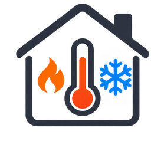
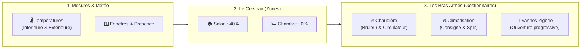

<p align="center">
  
</p>

# Super Thermostat

> **Le confort parfait dans chaque pièce, au degré près, sans une seule ligne de YAML !**  
> Inspiré du légendaire moteur temporel à **auto-apprentissage** du plugin *Thermostat* de Jeedom, repensé et magnifié pour Home Assistant.


## ⏱️ Le principe en 30 secondes : « Le Chef d'Orchestre »

Plutôt que de brancher bêtement un thermostat sur une chaudière et d'espérer que tout se passe bien, **Super Thermostat** sépare l'intelligence de l'action :



1. **Les Zones (Le Cerveau)** 🧠 : Une zone par pièce. Elle observe la température, regarde la météo dehors, calcule un **pourcentage de puissance (0 à 100 %)** et apprend de ses erreurs au fil des jours. Elle ne touche directement à aucun appareil.
2. **La Fraction Chaudière (Le Baromètre Malin)** ⚖️ : Fait-il doux dehors ? On privilégie la clim/PAC (économique). Fait-il un froid de canard ? La chaudière prend le relais à 100 %.
3. **Les Gestionnaires (Les Musiciens)** 🎸 : La chaudière additionne les besoins des pièces, module sa température d'eau (loi d'eau), la clim règle son soufflage, et les têtes thermostatiques s'ouvrent pile au bon niveau.

---

## 🎓 Le Petit Lexique (pour tout comprendre sans mal de crâne)

Pour régler votre thermostat comme un pro, voici les 4 notions clés démystifiées :

* 🚀 **Puissance de chauffe (montée en T°)** : *La pédale d'accélérateur.* C'est la force de frappe de vos radiateurs pour combler un écart entre la température actuelle et votre consigne. Plus il est grand, plus le thermostat envoie de la puissance quand la pièce est froide.
* 🛡️ **Compensation déperditions (isolation)** : *Le bouchon de la passoire.* Même quand la pièce est à 20 °C, elle perd des calories vers l'extérieur. Ce coefficient anticipe le froid dehors et injecte juste ce qu'il faut d'énergie pour compenser les fuites de la maison.
* 🍲 **Loi d'eau** : *La soupe adaptée à la météo.* Inutile d'envoyer de l'eau à 65 °C dans les radiateurs quand il fait 12 °C dehors ! La loi d'eau chauffe l'eau de la chaudière juste à la bonne température selon le froid extérieur.
* 🧘 **Hystérésis** : *La zone de tranquillité.* Empêche votre chaudière ou votre compresseur de clim de s'allumer et s'éteindre toutes les 30 secondes pour 0,1 °C d'écart.

---

## 🎛️ Les 4 Types d'Entrées

Créez vos briques en quelques clics dans **Paramètres → Appareils et services → Ajouter une intégration → Super Thermostat**.

> Dans l'ordre conseillé de mise en route :
> 1. [⚖️ Fraction Chaudière](#-3-la-fraction-chaudière)
> 2. [🏠 Zone Normale (Radiateurs ou Clim seule)](#-1-la-zone-normale-radiateurs-ou-clim-seule)
> 3. [⚡ Zone Combinée (Chaudière + Clim)](#-2-la-zone-combinée-chaudière--climatisation)
> 4. [🔥 Gestion Chaudière & ❄️ Gestion Clim](#-4-gestion-chaudière--gestion-clim)

---

### 🏠 1. La Zone Normale (Radiateurs ou Clim seule)

Le thermostat individuel de chaque pièce.

* **Deux consignes indépendantes** : Consigne de chauffe (ex: 20 °C) et consigne de froid (ex: 25 °C). Entre les deux, vous êtes en « zone morte » : repos total, silence et économies ! *(Astuce : consigne de froid à 35 °C = clim coupée).*
* **Auto-apprentissage Magique** 🪄 : Au fil des cycles, la zone analyse la vitesse à laquelle la pièce se réchauffe et ajuste toute seule ses 2 coefficients :
  * `Puissance de chauffe (montée en T°)` : s'adapte à la puissance réelle de vos radiateurs.
  * `Compensation déperditions (isolation)` : s'adapte à l'isolation thermique de la pièce.
* **Détection des fenêtres ouvertes** 🪟 : Coupe automatiquement le chauffage après un délai réglable, et redémarre quand tout est refermé.
* **Préréglages d'un clic** 🛋️ : `Jour` (Home), `Nuit` (Sleep), `Parti` (Away) disponibles directement sur vos cartes Home Assistant avec leurs belles icônes.

#### 🚰 Vannes thermostatiques intelligentes (Zigbee / Z-Wave)
Vos radiateurs ont des têtes motorisées ? Fini le gaspillage !
* **Ouverture proportionnelle** : À 20 % de demande, la vanne s'entrouvre à 25 %. À 100 %, elle s'ouvre en grand.
* **Synchronisation vanne ➔ chaudière** ⏳ : Pourquoi allumer la chaudière alors que les vannes mettent 5 minutes à s'ouvrir ? Si vos têtes ont un capteur *Commande en attente*, la zone attend que la vanne soit prête avant d'appeler la chaudière !
* **Alerte vanne bloquée / pile morte** 🚨 : Un capteur binaire vous avertit si une vanne refuse de suivre sa consigne.

---

### ⚡ 2. La Zone Combinée (Chaudière + Climatisation)

**Le duo gagnant pour les pièces équipées à la fois de radiateurs à eau et d'un split de clim réversible !**

```
           ┌─── CHAUDIÈRE (Base douce et silencieuse) ───► Confort régulier
PIÈCE ────┤
           └─── CLIM REVERSIBLE (Fusée de relance)   ───► Réactivité éclair & Climatisation d'été
```

Chaque équipement a son rôle et ses réglages dédiés :

* 🔥 **En CHAUFFAGE** :
  * **La Chaudière en base lente** : Elle assure le fond chaud avec ses **deux coefficients** (`Puissance de chauffe` et `Compensation déperditions`), lissés sur une moyenne glissante pour ne pas réagir aux courants d'air.
  * **La Clim en appoint rapide** : Elle enclenche la post-combustion si la pièce est trop froide pour remonter la température à toute vitesse, ou si la fraction chaudière la réclame.
* ❄️ **En REFROIDISSEMENT (Été)** :
  * La chaudière dort tranquillement.
  * La clim prend le contrôle avec ses **deux coefficients froid** (`Puissance clim (baisse en T°)` et `Protection chaleur (isolation)`) pour maintenir la fraîcheur même en pleine canicule !
* 🔄 **Apprentissages séparés** : La chaudière apprend ses coefficients de chauffe, la clim apprend ses coefficients de froid. Elles ne se marchent plus jamais sur les pieds !

---

### ⚖️ 3. La Fraction Chaudière

Vous avez une pompe à chaleur / clim réversible ET une chaudière (gaz, fioul, granulés) ?  
**La Fraction Chaudière décide intelligemment qui doit chauffer !**

* ☀️ **Météo douce (> 9 °C)** : Rendement de la PAC optimal ➔ Fraction à **0 %** (la clim chauffe, la chaudière se repose).
* ⛅ **Entre deux (-3 °C à 9 °C)** : Les deux travaillent en tandem.
* ❄️ **Grand froid (< -3 °C)** : Rendement de la PAC en chute ➔ Fraction à **100 %** (les radiateurs chaudière prennent le relais total).

Elle publie en permanence la fraction calculée sur la **moyenne de la veille** (très stable) et sur la **température actuelle** (temps réel).

---

### 🔥 4. Gestion Chaudière & ❄️ Gestion Clim

Ce sont les chefs de chantier qui reçoivent les demandes des zones :

* **Gestion Chaudière** 🏭 :
  * Reçoit les pourcentages de toutes les pièces. Si la demande totale dépasse 0 %, elle active le circulateur et pilote le brûleur.
  * **Loi d'eau automatique** : Calcule en continu la température idéale de l'eau (seuil bas d'allumage et seuil haut d'extinction).
  * **Sécurités intégrées** : Durées minimales on/off pour préserver le brûleur, post-circulation et coupure en cas de surchauffe (> 85 °C).
* **Gestion Clim** 💨 :
  * Reçoit la demande globale des pièces et pilote votre entité `climate` existante (Daikin, Mitsubishi, etc.).
  * Calcule le décalage de consigne optimal selon l'effort demandé et respecte les temps de repos du compresseur.

---

## 🚀 Mise en Route en 5 Étapes Faciles

```
  [1. Fraction Chaudière]
             │
             ▼
  [2. Création des Zones] ────► 1 par pièce (salon, chambres...)
             │
             ▼
  [3. Gestionnaires (Chaudière & Clim)]
             │
             ▼
  [4. Mode Simulation] ────────► On observe sans allumer les relais !
             │
             ▼
  [5. Feu Vert !] ─────────────► On coupe les vieilles automatisations et on profite !
```

1. **Installez l'intégration** via HACS (*Dépôt personnalisé*) ou en copiant le dossier dans `/config/custom_components/super_thermostat/`.
2. **Ajoutez la Fraction Chaudière** en renseignant votre sonde météo extérieure.
3. **Créez vos Zones** : Donnez un nom, liez la sonde de la pièce, et activez les vannes si vous en avez.
4. **Créez la Gestion Chaudière et/ou Clim** : Sélectionnez vos relais de brûleur/circulateur et cochez **Simulation**.
5. **Vérifiez les jauges sur votre tableau de bord**, admirez la loi d'eau réagir, puis décochez **Simulation** : votre maison est désormais auto-régulée ! 🎉

---

## 📊 Loi d'Eau Interactive

Curieux de voir comment réagit la température d'eau de votre chaudière selon le froid extérieur ?  
L'intégration inclut un calculateur interactif !


👉 **[Tester le Configurateur de Loi d'Eau en ligne](https://maxime-roche.github.io/super_thermostat/configurateur.html)** *(simulateur graphique complet).*

---

## 💡 Tableau des Solutions aux Petits Tracas

| Situation | Que se passe-t-il ? | Solution minute |
| :--- | :--- | :--- |
| **La chaudière ne s'allume pas alors qu'une pièce demande du chaud** | La pièce attend peut-être que ses têtes thermostatiques soient bien ouvertes. | Regardez le capteur `En attente de la vanne`. Dès que la vanne répond (ou après le délai de sécurité), la chaudière démarre ! |
| **Les coefficients ne changent pas** | L'auto-apprentissage a besoin de cycles normaux pour apprendre. | Vérifiez que l'option *Auto-apprentissage* est cochée. S'il fait très doux ou que la consigne n'est jamais sollicitée, c'est normal. |
| **La pièce chauffe trop fort d'un coup** | Le coefficient de puissance de chauffe est sans doute réglé un peu haut. | Baissez manuellement le `Puissance de chauffe (montée en T°)` ou cliquez sur **Réinitialiser l'apprentissage**. |
| **Alerte : Sonde de température périmée** | Votre sonde Zigbee sur pile a espacé ses messages ou n'émet plus. | L'intégration passe en puissance de sécurité pour éviter de geler. Vérifiez la pile de votre sonde ! |
| **Je veux couper le chauffage d'une pièce** | Vous partez ou vous aérez longtemps ? | Basculez la zone sur `Off` ou ouvrez la fenêtre : tout se coupe instantanément. |

---

## 📜 Historique des Versions

| Version | Nouveautés & Améliorations |
| :---: | :--- |
| **1.3.0** | 🎯 **Coefficients plus intuitifs** : renommage clair des variables d'apprentissage (`Puissance de chauffe` et `Compensation déperditions`).<br>⚡ **Zone combinée repensée** : 2 variables chaud pour la chaudière + 2 variables froid pour la clim avec apprentissages indépendants.<br>🐛 **Correctif Presets** : prise en charge native des clics UI sur les préréglages (*Jour*, *Nuit*, *Confort*...).<br>🧹 Nettoyage des interrupteurs pour la gestion clim. |
| **1.2.0** | 🚰 Refonte des vannes thermostatiques avec champ libre de consigne et synchronisation attente-vanne.<br>⏱️ Double onglet de régulation pour la zone combinée. |
| **1.1.0** | 🍲 Loi d'eau chaudière régie par la fraction météo.<br>🌀 Gestion native du ventilateur Daikin dans l'entité climate. |
| **1.0.0** | 🚀 Première version majeure avec surveillance des vannes minute par minute et alertes de défaillance. |

---

## 🤝 Crédits & Licence

La logique de régulation thermique (calcul temporel, anticipation météo et auto-apprentissage par pondération) est issue du fabuleux plugin *Thermostat* de [Jeedom](https://www.jeedom.com), sous licence **GPLv3**.  
Super Thermostat est distribué sous la même licence libre **GPLv3**. Vive l'open source et le confort domotique ! ☕
